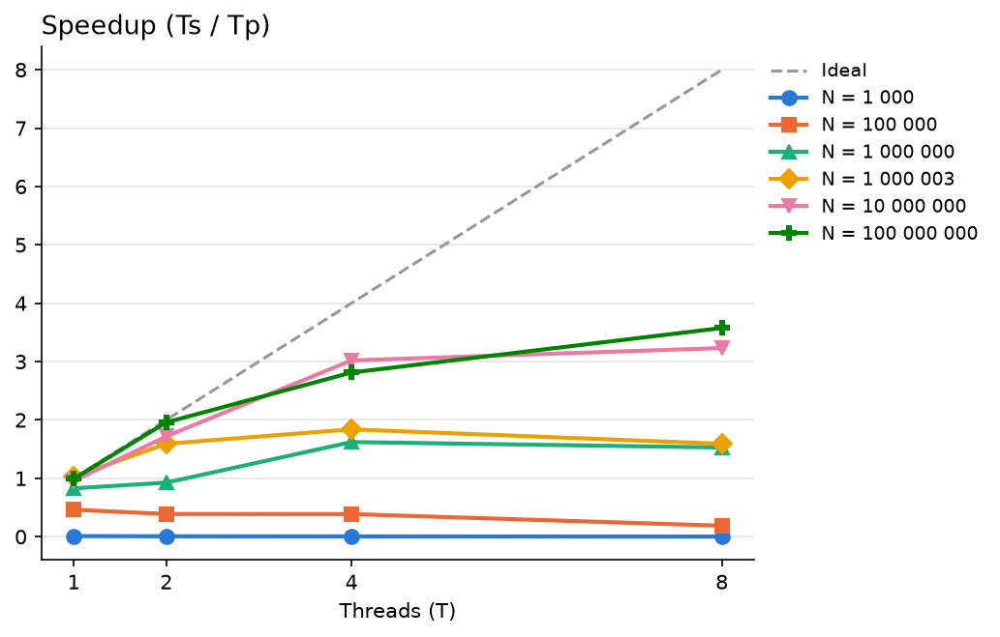
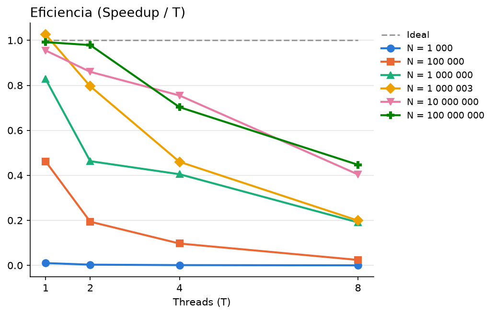
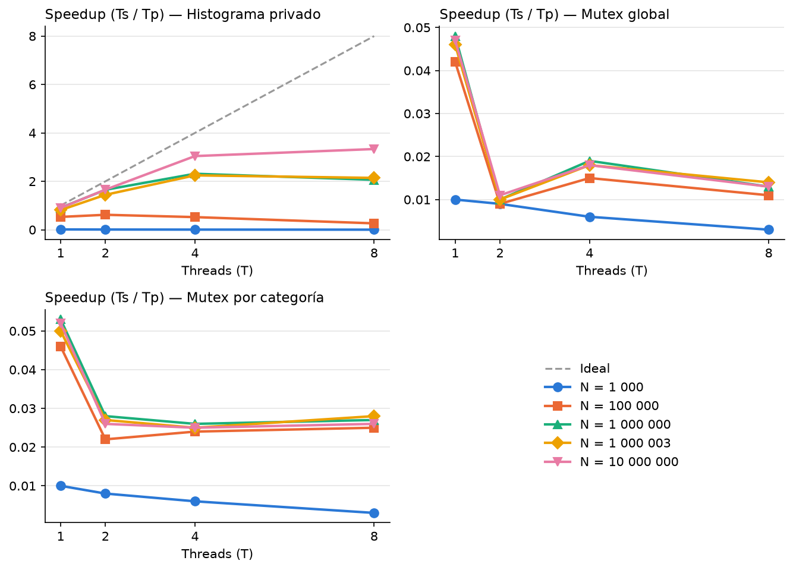
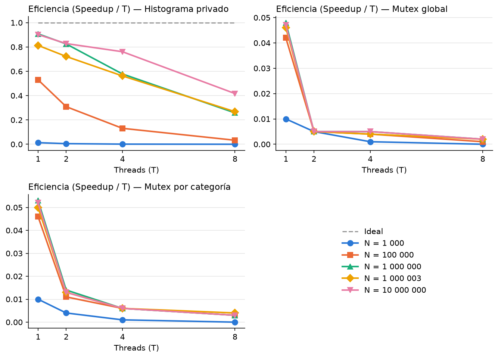
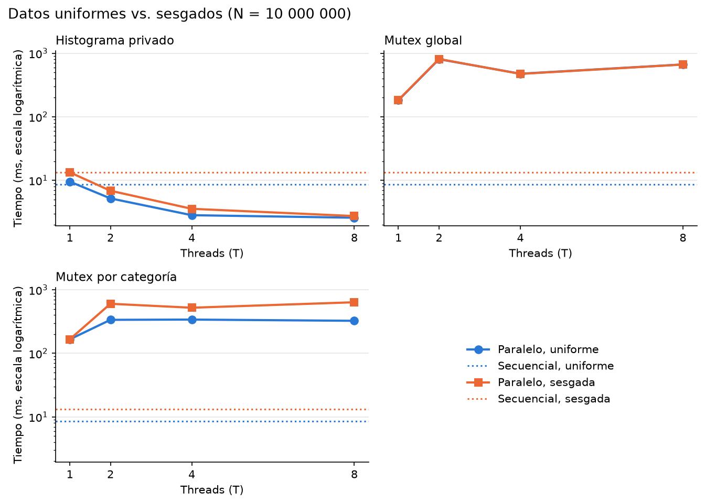
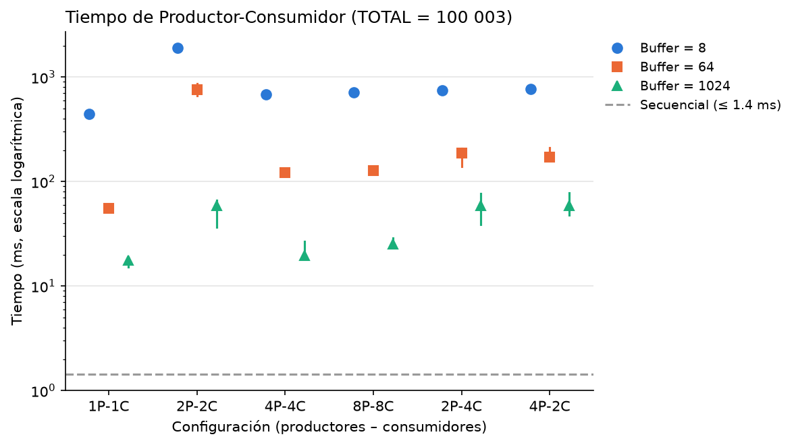

# Laboratorio A: Programación con Pthreads — Reducciones, Histograma y Sincronización

**Universidad Nacional de San Agustín — Escuela Profesional de Ciencia de la Computación**

- **Nombre:** David Tamo Turpo
- **Curso:** Computación Paralela y Distribuida
- **Profesor:** Alvaro Henry Mamani Aliaga
- **Informe en PDF:** [`Informe_Laboratorio_A.pdf`](Informe_Laboratorio_A.pdf)

---

## 1. Estructura del repositorio

| Archivo / Carpeta | Descripción |
|:--|:--|
| [`p1sec.c`](p1sec.c), [`p1par.c`](p1par.c) | **Parte I — Estadísticas de un conjunto de datos:** suma, mínimo, máximo y promedio (secuencial y paralelo por bloques con acumuladores locales) |
| [`p2sec.c`](p2sec.c), [`p2mutex.c`](p2mutex.c), [`p2mutexcat.c`](p2mutexcat.c), [`p2priv.c`](p2priv.c) | **Parte II — Construcción paralela de un histograma:** secuencial, con mutex global, con un mutex por categoría (`_Alignas(64)`) y con histograma privado por thread |
| [`p3sec.c`](p3sec.c), [`p3par.c`](p3par.c) | **Parte III — Productores y consumidores con buffer acotado:** cola circular sincronizada con un mutex y dos variables de condición (`no_lleno`, `no_vacio`) |
| [`experimentos_p1.sh`](experimentos_p1.sh), [`experimentos_p2.sh`](experimentos_p2.sh), [`experimentos_p3.sh`](experimentos_p3.sh) | Scripts `.sh` que compilan, registran el hardware (`entorno_pN.txt`), ejecutan todas las combinaciones, guardan los CSV en bruto y llaman a los scripts de análisis |
| [`analizar_p1.py`](analizar_p1.py), [`analizar_p2.py`](analizar_p2.py), [`analizar_p3.py`](analizar_p3.py) | Verifican correctitud contra la referencia secuencial, calculan speedup y eficiencia y generan las gráficas en `.png` y [`figuras/`](figuras/) |
| [`cambios_contexto_p3.py`](cambios_contexto_p3.py), [`cambios_contexto_p3.csv`](cambios_contexto_p3.csv) | Mide con `getrusage` los cambios de contexto voluntarios e involuntarios en la Parte III |
| [`datos_p1.csv`](datos_p1.csv), [`datos_p2.csv`](datos_p2.csv), [`datos_p3.csv`](datos_p3.csv), [`repartos.txt`](repartos.txt) | Mediciones en bruto (mediana, mínima y máxima de 7 repeticiones) y reparto de índices `[inicio, fin)` |
| [`resultados_p1.csv`](resultados_p1.csv), [`resultados_p2.csv`](resultados_p2.csv), [`resultados_p2_dist.csv`](resultados_p2_dist.csv), [`resultados_p3.csv`](resultados_p3.csv) | Tablas procesadas con verificación (`OK`), tiempos, speedup y eficiencia |
| [`Informe_Laboratorio_A.pdf`](Informe_Laboratorio_A.pdf), [`informe/`](informe/) | Informe completo en PDF y sus fuentes en Markdown/Typst (`informe/tablas.py` actualiza las tablas automáticamente desde los CSV) |
| [`Laboratorio_A_Explicado.md`](Laboratorio_A_Explicado.md), [`explicacion_experimentos_p1.md`](explicacion_experimentos_p1.md), [`explicacion_experimentos_p2.md`](explicacion_experimentos_p2.md), [`explicacion_experimentos_p3.md`](explicacion_experimentos_p3.md) | Explicación detallada paso a paso del código en C, de los scripts `.sh` y del análisis en Python |
| [`prueba_sin_calentamiento/`](prueba_sin_calentamiento/) | Estudio experimental comparando mediciones con calentamiento (`r = -1`), sin calentamiento (`r = 0..6`) y 1.ª vuelta en frío (`r = 0`) — ver [`COMPARACION.md`](prueba_sin_calentamiento/COMPARACION.md) |
| [`version_anterior/`](version_anterior/) | Respaldo de la primera versión |

---

## 2. Explicación detallada de los scripts `.sh`

Cada parte cuenta con un script POSIX (`.sh`) que automatiza todo el flujo experimental para no ejecutar ni copiar ningún dato a mano:

```bash
sh experimentos_p1.sh   # Parte I: Estadísticas
sh experimentos_p2.sh   # Parte II: Histograma (uniforme y sesgado)
sh experimentos_p3.sh   # Parte III: Productores y consumidores + cambios de contexto
```

### 2.1 Cómo funcionan por dentro los tres `.sh`

1. **Formato decimal estandarizado (`export LC_ALL=C`):**
   Al inicio de cada script se define `export LC_ALL=C`. En sistemas Linux configurados en español, utilidades como `awk` usan coma decimal (`0,054`), lo que desplazaría las columnas al escribir un archivo CSV separado por comas. Con `LC_ALL=C` se garantiza el uso de punto decimal (`0.054`).

2. **Compilación con verificación de errores (`|| exit 1`):**
   Todos los ejecutables se compilan con `gcc -O2 -pthread`:
   ```sh
   gcc -O2 -pthread p1sec.c -o p1sec || exit 1
   gcc -O2 -pthread p1par.c -o p1par || exit 1
   ```
   Tanto la versión secuencial como las paralelas usan `-O2` para que la comparación de tiempos sea justa, y `|| exit 1` aborta el script si algún archivo falla al compilar.

3. **Registro del entorno de hardware (`entorno_pN.txt`):**
   Antes de iniciar las corridas, un bloque agrupado entre llaves redirige a `entorno_pN.txt` la fecha exacta, el kernel (`uname -sr`), el modelo y topología de CPU (`lscpu`), la memoria RAM (`free -h`) y la versión de `gcc`:
   ```sh
   { date; uname -sr; lscpu | grep -E "Model name|^CPU\(s\)|Thread|Core|Socket"; free -h; gcc --version | head -n 1; } > entorno_p1.txt
   ```

4. **Extracción automática de la salida de C hacia CSV (`guardar_fila` con `awk`):**
   Los programas en C imprimen cada métrica en líneas del tipo `Clave = Valor` (por ejemplo, `Suma = 489014`, `Tiempo paralelo (mediana de 7) = 0.000060700 s`, `Tiempo minimo = ...`, `Tiempo maximo = ...`). La función `guardar_fila()` captura toda la salida del programa y extrae los valores con `awk`:
   ```sh
   guardar_fila() {
       VALORES=$(echo "$4" | awk -F'= ' '/^(Suma|Minimo|Maximo|Promedio|Tiempo)/ {sub(/ s$/, "", $2); printf ",%s", $2}')
       echo "$1,$2,$3$VALORES" >> datos_p1.csv
   }
   ```
   - `-F'= '` parte cada línea en dos campos: `$1` (lo que está antes de `= `) y `$2` (el valor numérico después de `= `).
   - La expresión regular filtra solo las líneas de interés en el orden en que las imprime el programa.
   - `sub(/ s$/, "", $2)` elimina la unidad `" s"` al final de las líneas de tiempo.
   - `printf ",%s", $2` concatena todos los valores en una sola cadena `,suma,minimo,maximo,promedio,tiempo,t_min,t_max` que luego `echo` escribe en `datos_pN.csv`.

5. **Bucles de experimentación de cada script:**
   - **[`experimentos_p1.sh`](experimentos_p1.sh):**
     Recorre `VALORES_N="1000 100000 1000000 1000003 10000000 100000000"` (incluyendo `1000003`, que no es divisible entre 2, 4 ni 8). Por cada `N`, corre una vez `./p1sec "$N"` y luego recorre `VALORES_T="1 2 4 8"` ejecutando `./p1par "$N" "$T"`. Además, filtra con `grep '^Thread [0-9]'` las líneas donde cada hilo reporta su rango `[inicio, fin)` y las guarda en [`repartos.txt`](repartos.txt). Al terminar ejecuta `python3 analizar_p1.py`.
   - **[`experimentos_p2.sh`](experimentos_p2.sh):**
     Define la función `experimento()`, que recibe la distribución (`u` uniforme o `s` sesgada) y el tamaño `N`: ejecuta primero `./p2sec "$N" "$dist"` y después, para cada `T` en `1 2 4 8`, corre las tres estrategias paralelas (`./p2mutex`, `./p2mutexcat` y `./p2priv`). El script ejecuta `experimento u "$N"` para `1000`, `100000`, `1000000`, `1000003` y `10000000`, y luego `experimento s 10000000` (donde ~91 % de los valores caen en la categoría 0). Finalmente llama a `python3 analizar_p2.py`.
   - **[`experimentos_p3.sh`](experimentos_p3.sh):**
     Recorre `BUFFERS="8 64 1024"` con `TOTAL=100003`. Para cada tamaño de buffer ejecuta `./p3sec "$TOTAL" "$B"` y luego recorre `PARES_PC="1:1 2:2 4:4 8:8 2:4 4:2"`. Mediante expansión de parámetros POSIX (`P=${PC%:*}` obtiene el número antes de `:` y `C=${PC#*:}` el número después de `:`), invoca `./p3par "$TOTAL" "$P" "$C" "$B"`. Al terminar ejecuta `python3 analizar_p3.py` y `python3 cambios_contexto_p3.py > cambios_contexto_p3.csv`.

---

## 3. Compilación y ejecución manual de cada programa

```bash
gcc -O2 -pthread p1sec.c -o p1sec            # ./p1sec N
gcc -O2 -pthread p1par.c -o p1par            # ./p1par N T
gcc -O2 -pthread p2sec.c -o p2sec            # ./p2sec N [u|s]
gcc -O2 -pthread p2mutex.c -o p2mutex        # ./p2mutex N T [u|s]
gcc -O2 -pthread p2mutexcat.c -o p2mutexcat  # ./p2mutexcat N T [u|s]
gcc -O2 -pthread p2priv.c -o p2priv          # ./p2priv N T [u|s]
gcc -O2 -pthread p3sec.c -o p3sec            # ./p3sec TOTAL TAM_BUFFER
gcc -O2 -pthread p3par.c -o p3par            # ./p3par TOTAL P C TAM_BUFFER
```

Para regenerar las tablas y el informe PDF:

```bash
python informe/tablas.py
pandoc informe/0*.md --columns=250 --pdf-engine=typst -o Informe_Laboratorio_A.pdf
```

---

## 4. Gráficos generados

### Parte I — Reducción paralela (`p1sec` vs. `p1par`)



### Parte II — Histograma paralelo (`p2priv`, `p2mutex`, `p2mutexcat`)




### Parte III — Productores y consumidores (`p3sec` vs. `p3par`)

