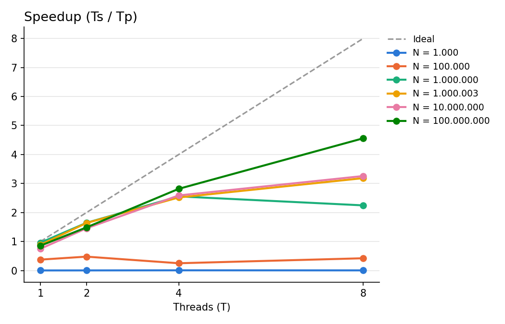
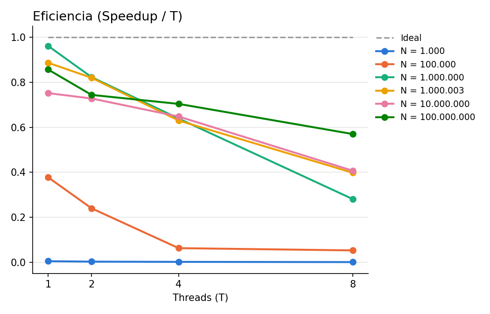
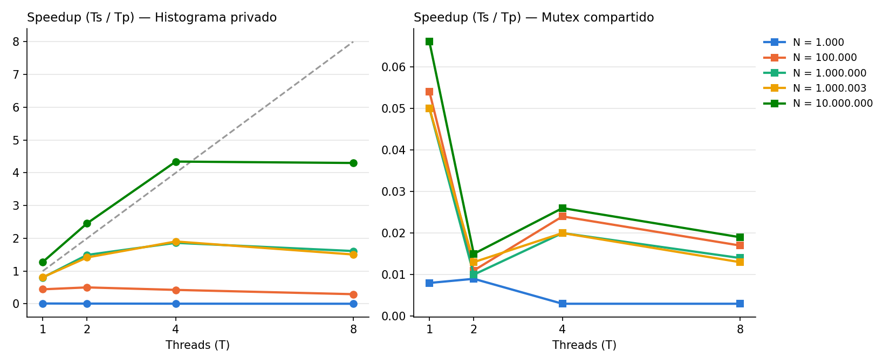
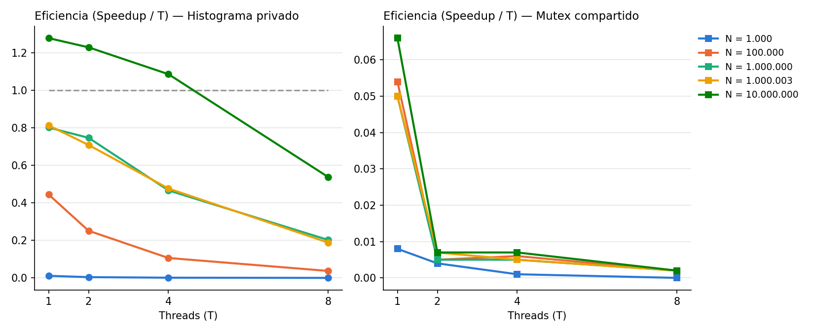
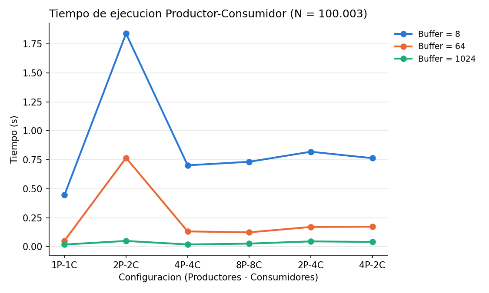

# Laboratorio A — Programación con Pthreads: Reducciones, Histograma y Sincronización

Explicación **para dummies** paso a paso + **Informe académico completo** con tablas, gráficos y respuestas a todas las preguntas del PDF.

> **Cómo leer este documento:**
> - **Primera mitad (Secciones 0 a 3):** Explicación **para dummies** de todo el laboratorio: analogías cotidianas, ejemplos con números chiquitos, dibujos en texto de qué pasa en memoria, cómo funciona cada archivo `.c` y `.sh`, y las respuestas fáciles a todas las preguntas del PDF.
> - **Segunda mitad (Informe académico — Secciones 1 a 7 del PDF):** Redacción formal lista para entregar en el informe, con las tablas experimentales completas, los gráficos generados (`speedup.png`, `eficiencia.png`, `speedup_p2.png`, `eficiencia_p2.png`, `tiempos_p3.png`), las fórmulas y las respuestas técnicas.

---

## 0. Las 7 ideas que necesitas antes de empezar (para dummies)

| Concepto | En cristiano (para dummies) |
|---|---|
| **Thread (hilo)** | Un **trabajador** dentro de tu programa. Si creas 4 threads, tienes 4 trabajadores operando al mismo tiempo sobre la misma memoria. |
| **Variable compartida** | Una **pizarra en la pared** que todos los threads pueden mirar y modificar. |
| **Variable local / privada** | Una **libreta personal** de cada thread: solo él escribe ahí y nadie más la toca mientras trabaja. |
| **Condición de carrera** | Dos threads intentan actualizar la misma casilla de la pizarra **al mismo tiempo** y uno pisa el resultado del otro. El resultado sale mal y cambia en cada ejecución. |
| **Mutex (`pthread_mutex_t`)** | Un **candado** (o la única tiza del salón): solo el thread que tiene el candado puede tocar la pizarra; los demás hacen fila. |
| **Variable de condición (`pthread_cond_t`)** | Una **sala de espera con timbre**: si un thread ve que no puede avanzar (ej. el buffer está lleno o vacío), suelta el candado y se **duerme** hasta que otro thread toque el timbre (`signal`). |
| **Speedup y Eficiencia** | **Speedup** = `Ts / Tp` (cuántas veces más rápido fue el paralelo que el secuencial). **Eficiencia** = `Speedup / T` (qué tanto rindió cada thread: `1.0` = 100 % ideal). |

### Las 6 funciones de Pthreads que usamos en todo el laboratorio

```c
pthread_create(&hilo, NULL, funcion, &arg);  // Contrata un thread para que ejecute 'funcion(&arg)'
pthread_join(hilo, NULL);                    // Espera a que ese thread termine su trabajo
pthread_mutex_lock(&candado);                // Cierra el candado (si otro lo tiene, espera en la fila)
pthread_mutex_unlock(&candado);              // Abre el candado para que pase el siguiente
pthread_cond_wait(&condicion, &candado);     // Suelta el candado y se duerme hasta que le avisen; al despertar recupera el candado
pthread_cond_signal(&condicion);             // Despierta a un thread que esté dormido en 'condicion'
```

---

## Parte I (Para Dummies) — Estadísticas de un conjunto de datos (`p1sec.c` y `p1par.c`)

### ¿Qué piden en una frase?
Dado un arreglo gigante de `N` números enteros (entre `0` y `999`), calcular la **suma total**, el **mínimo**, el **máximo** y el **promedio**, repartiendo el arreglo entre `T` threads incluso cuando `N` no se pueda dividir exacto entre `T`.

### La idea general con colores
- 🔵 **Secuencial (`p1sec.c`):** Una sola persona recorre los `N` números de principio a fin y anota suma, mínimo, máximo y promedio.
- 🟢 **Paralelo (`p1par.c`):** Cortamos el arreglo en `T` pedazos seguidos. Cada thread recorre **su pedazo** usando **variables locales** y al terminar anota sus 3 resultados parciales (`suma`, `min`, `max`) en su propia estructura (`ArgsThread`, su "libreta").
- 🟣 **Combinación final:** Cuando todos los threads terminan (`pthread_join`), el `main` lee las `T` libretas, suma los subtotales, saca el menor de los mínimos, el mayor de los máximos y divide la suma global entre `N`. **Sin usar ningún mutex.**

### Forma 1 — Analogía: contar billetes en un banco
Imagina que llegan **1.000.003 billetes** al banco y hay **4 cajeros** (`T = 4`):
1. Partimos el fajo de billetes en 4 montones casi iguales (3 cajeros reciben `250.001` billetes y el último recibe `250.000`).
2. Cada cajero cuenta **en silencio en su propio escritorio** (variables locales en registros del CPU) cuánto suman sus billetes, cuál fue el billete más chico y cuál el más grande.
3. Cuando terminó, escribe esos 3 números en su hoja personal (`args[id].suma`, `args[id].min`, `args[id].max`).
4. Cuando los 4 terminaron (`pthread_join`), el gerente junta las 4 hojas y suma los 4 números. ¡Nadie se peleó por una pizarra!

### Forma 2 — ¿Cómo funciona la fórmula cuando `N` no es múltiplo de `T`?
En `p1par.c` (líneas 75–81) usamos esta división entera con resto:

```c
long base  = N / T;   // cuántos recibe cada thread como mínimo
long resto = N % T;   // cuántos elementos "sobran"

args[id].inicio = id * base + (id < resto ? id : resto);
args[id].fin    = args[id].inicio + base + (id < resto ? 1 : 0);
```

Hagámoslo con **números chiquitos**: imagina `N = 10` elementos (índices `0` al `9`) y `T = 4` threads:
- `base = 10 / 4 = 2` (todos reciben al menos 2 elementos).
- `resto = 10 % 4 = 2` (sobran 2 elementos, así que **los primeros 2 threads** —`id = 0` e `id = 1`— reciben **1 elemento extra**).

| Thread (`id`) | ¿`id < resto` (`id < 2`)? | `inicio` | `fin` | Segmento `[inicio, fin)` | Cantidad |
|---|---|---|---|---|---|
| **Thread 0** | Sí (`0 < 2`) | `0*2 + 0 = 0` | `0 + 2 + 1 = 3` | `[0, 3)` → índices `0, 1, 2` | **3 elementos** |
| **Thread 1** | Sí (`1 < 2`) | `1*2 + 1 = 3` | `3 + 2 + 1 = 6` | `[3, 6)` → índices `3, 4, 5` | **3 elementos** |
| **Thread 2** | No (`2 < 2` falso) | `2*2 + 2 = 6` | `6 + 2 + 0 = 8` | `[6, 8)` → índices `6, 7` | **2 elementos** |
| **Thread 3** | No (`3 < 2` falso) | `3*2 + 2 = 8` | `8 + 2 + 0 = 10` | `[8, 10)` → índices `8, 9` | **2 elementos** |

¡Fíjate que no queda ningún hueco ni ningún elemento repetido (`3 + 3 + 2 + 2 = 10`), y la diferencia máxima de carga entre cualquier par de threads es de **a lo sumo 1 elemento**!
En nuestras pruebas reales con `N = 1.000.003` y `T = 4` (guardado en `repartos.txt`):
- Threads `0, 1, 2`: reciben `250.001` elementos cada uno.
- Thread `3`: recibe `250.000` elementos.

### Forma 3 — El dibujo de la condición de carrera (si no usáramos variables locales)
¿Qué pasaría si todos los threads hicieran `suma_global += datos[i]` directamente sin sincronización?
Aunque en C se escribe en una línea, para el procesador `suma_global += x` son **3 pasos separados** (1: Leer de RAM a registro, 2: Sumar en el registro, 3: Escribir de vuelta en RAM):

```text
Instante   Thread 0 (quiere sumar 50)        Thread 1 (quiere sumar 30)        suma_global en RAM
   1       Lee suma_global (vale 100)                                          100
   2                                         Lee suma_global (vale 100)        100
   3       Calcula 100 + 50 = 150                                              100
   4                                         Calcula 100 + 30 = 130            100
   5       Escribe 150 en RAM                                                  150
   6                                         Escribe 130 en RAM                130  <-- ¡SE PERDIÓ EL +50!
```

### Preguntas de análisis de la Parte I (respondidas para dummies)

1. **¿Por qué conviene calcular resultados parciales en cada thread?**
   Porque así cada thread acumula `suma`, `min` y `max` en **variables locales privadas** (que el compilador guarda directamente en registros ultrarrápidos del procesador) sin tocar la memoria de los demás threads ni hacer fila en un mutex. Además, evita el *false sharing* (que dos núcleos se peleen por la misma línea de caché en cada iteración).
2. **¿Qué problema surgiría si todos los threads actualizaran una única variable de suma sin sincronización?**
   Ocurriría una **condición de carrera** (*race condition* / *lost update*): dos o más threads leerían el mismo valor viejo de `suma` antes de que el otro escriba su resultado, pisándose entre sí. La suma final saldría **menor que la real** y daría un número distinto cada vez que ejecutes el programa.
3. **¿Es necesario utilizar un mutex para combinar los resultados parciales? Justifique su estrategia.**
   **No es necesario en nuestra estrategia**, porque cada thread escribe su resultado parcial en su propia posición `args[id]` (ningún otro thread escribe en `args[id]`), y el hilo principal recién combina los `T` resultados **después** de que terminaron todos los `pthread_join`. Como `pthread_join` actúa como barrera de sincronización y después solo trabaja un hilo (el `main`), no hay concurrencia al combinar. *(Si en cambio cada thread sumara a una variable global dentro de su función antes de terminar, ahí sí haría falta un mutex).*
4. **¿Cómo se distribuye el trabajo cuando N no es múltiplo del número de threads?**
   Se calcula el cociente entero `base = N / T` y el residuo `resto = N % T`. Los primeros `resto` threads (`id < resto`) reciben `base + 1` elementos contiguos y los demás (`T - resto` threads) reciben `base` elementos contiguos. Así el trabajo queda perfectamente balanceado (máximo 1 elemento de diferencia).
5. **¿Por qué el speedup puede ser menor que el número de threads?**
   Por cuatro razones prácticas:
   - **Costo fijo (overhead) de Pthreads:** Crear (`pthread_create`) y esperar (`pthread_join`) threads toma alrededor de `0.1 a 0.3 ms`. Si `N` es pequeño (`1.000` o `100.000`), se tarda más contratando a los trabajadores que sumando los números.
   - **Ancho de banda de memoria (Memory Wall):** Sumar enteros hace muy pocas cuentas por cada byte leído de la RAM. Con 4 u 8 threads leyendo a máxima velocidad, el bus de memoria RAM se llena y los núcleos tienen que esperar datos.
   - **Ley de Amdahl:** Siempre hay una parte secuencial (repartir, crear hilos, combinar los `T` resultados) que no se acelera.
   - **Frecuencia Turbo y planificación del SO:** Un solo núcleo activo suele correr a mayor frecuencia Turbo que 8 núcleos activos a la vez.

---

## Parte II (Para Dummies) — Construcción paralela de un histograma (`p2sec.c`, `p2mutex.c` y `p2priv.c`)

### ¿Qué piden en una frase?
Dado un arreglo de `N` números entre `0` y `99`, contar cuántos caen en cada una de las **10 decenas** (`0–9`, `10–19`, `20–29`, ..., `90–99`), comprobar que las 10 casillas sumen `N`, y comparar dos formas de hacerlo con threads: **con un mutex compartido** vs. **con un histograma privado por thread**.

### Truco matemático para saber en qué casilla cae un número
Como los números van de `0` a `99` y son enteros en C, dividir entre `10` quita los decimales:
- Si `datos[i] = 7` → `7 / 10 = 0` (cae en la casilla `0`, que es `00–09`).
- Si `datos[i] = 48` → `48 / 10 = 4` (cae en la casilla `4`, que es `40–49`).
- Si `datos[i] = 99` → `99 / 10 = 9` (cae en la casilla `9`, que es `90–99`).

### Las dos estrategias paralelas cara a cara

```text
🟠 ESTRATEGIA 1: Mutex compartido (p2mutex.c)
   Todos los threads escriben en el MISMO hist_global[10].
   Por cada número (N veces):
      1. Cerrar candado (pthread_mutex_lock)
      2. hist_global[cat]++
      3. Abrir candado (pthread_mutex_unlock)
   👉 Resultado: Correcto, pero LENTÍSIMO (hacen fila 10 millones de veces).

🟢 ESTRATEGIA 2: Histograma privado por thread (p2priv.c)
   Cada thread tiene su propio arreglo local[10] = {0}.
   Durante todo su segmento (N/T números):
      local[cat]++   (¡en su libreta privada, SIN candado!)
   Al final (después de pthread_join), el main suma las 10 casillas de los T threads.
   👉 Resultado: Correcto y ULTRARRÁPIDO (0 filas durante el recorrido).
```

### Ejemplo con números reales medidos (`N = 10.000.000`, `T = 4` threads)

| Versión | Tiempo medido | Speedup vs. Secuencial | ¿10 categorías iguales y suman `10.000.000`? |
|---|---|---|---|
| 🔵 **Secuencial (`p2sec`)** | `0.012339 s` | `1.000x` | ✅ Sí (`10.000.000`) |
| 🟠 **Mutex compartido (`p2mutex`)** | `0.466603 s` | **`0.026x`** *(38 veces más lento)* | ✅ Sí (`10.000.000`) |
| 🟢 **Histograma privado (`p2priv`)** | `0.002842 s` | **`4.342x`** *(4.3 veces más rápido)* | ✅ Sí (`10.000.000`) |

¡Mira esa diferencia! Con 4 threads y `N = 10.000.000`, el **histograma privado** tarda `0.0028 s`, mientras que el **mutex compartido** tarda `0.4666 s` (**164 veces más lento** que el privado).

### Preguntas de análisis de la Parte II (respondidas para dummies)

1. **¿En qué situación se produce una condición de carrera al actualizar el histograma?**
   Se produce cuando **dos o más threads leen al mismo tiempo números que pertenecen a la misma categoría `cat`** (por ejemplo, el Thread 0 lee un `23` y el Thread 1 lee un `28`, ambos van a la categoría `2`, que es `20–29`) e intentan ejecutar `hist[2]++` simultáneamente sobre un mismo arreglo compartido sin protección. Como `hist[2]++` es leer-sumar-escribir, uno pisa el incremento del otro y la suma de las 10 categorías termina dando **menos que `N`**.
2. **¿Qué diferencias hay entre usar un mutex compartido y un histograma privado por thread?**
   - **Mutex compartido (`p2mutex.c`):** Usa **1 solo histograma global** y protege cada incremento con `pthread_mutex_lock/unlock`. Ejecuta `N` bloqueos de candado, serializa a los threads (solo uno puede contar a la vez) y provoca altísima contención de caché.
   - **Histograma privado (`p2priv.c`):** Usa **un arreglo de 10 enteros por cada thread** (`local[10]`). Cada thread trabaja 100 % en paralelo en su propia caché L1 sin bloquearse nunca, y al final el hilo principal hace apenas `10 × T` sumas simples. Consume apenas `80 bytes` extra de memoria por thread (`10 × 8 bytes`), que no es nada.
3. **¿Qué estrategia esperarías que escale mejor y por qué?**
   Escala muchísimo mejor el **histograma privado por thread (`p2priv`)**, porque elimina por completo la contención y la serialización durante el bucle de `N` elementos: el trabajo por thread baja como $O(N/T)$ y la combinación final cuesta solo $O(10 \cdot T)$, que para 10 categorías y 8 threads son apenas 80 sumas. En cambio, el mutex compartido no escala: al subir de 1 a 2 threads el tiempo empeora drásticamente porque los núcleos empiezan a pelearse por el candado.
4. **¿Cómo influye la distribución de los valores de entrada en la contención?**
   - Si se usa **un único mutex global** para todo el histograma, la contención es máxima sin importar qué valores salgan, porque cualquier categoría bloquea el mismo candado.
   - Si se usara **un mutex por categoría** (10 mutex, uno para cada casilla `0..9`), entonces la distribución de entrada influye directamente:
     - Si los datos son **uniformes** (todos los números entre 0 y 99 salen con igual probabilidad), los threads se reparten entre las 10 casillas y chocan con probabilidad $1/10$.
     - Si los datos están **sesgados o concentrados** (por ejemplo, casi todos los valores caen entre `0` y `9`), todos los threads pedirán siempre el mutex de la casilla `0`, generando un cuello de botella idéntico a tener un solo mutex global.
   - En cambio, con el **histograma privado por thread**, la distribución de entrada **no genera contención jamás**, porque cada thread toca únicamente su propio arreglo privado.

---

## Parte III (Para Dummies) — Productores y consumidores con buffer acotado (`p3sec.c` y `p3par.c`)

### ¿Qué piden en una frase?
Implementar una cola circular de tamaño fijo (`TAM_BUFFER`) donde `P` threads **productores** meten números y `C` threads **consumidores** los sacan, durmiendo cuando el buffer está lleno o vacío, y demostrando que **ni un solo número se pierde ni se consume dos veces**.

### Forma 1 — Analogía: La panadería con vitrina redonda
Imagina una panadería donde:
- Hay `P` **panaderos (productores)** que hornean panes numerados con un sello único (`0, 1, 2, ..., TOTAL-1`).
- Hay `C` **clientes (consumidores)** que compran panes.
- En el medio hay una **vitrina redonda giratoria (`buffer`)** donde solo caben `TAM_BUFFER` panes (digamos 8 panes).
- **Regla 1 (El candado / `mutex`):** Solo una persona (panadero o cliente) puede meter la mano en la vitrina a la vez. Si no, dos panaderos pondrían su pan en la misma bandeja o dos clientes agarrarían el mismo pan.
- **Regla 2 (Vitrina llena / `no_lleno`):** Si un panadero abre la vitrina y ve que ya hay 8 panes (`cuenta == TAM_BUFFER`), **cierra la vitrina y se sienta a dormir** en el sillón `no_lleno`. Cuando un cliente se lleve un pan, tocará la campanita `pthread_cond_signal(&no_lleno)` para despertarlo.
- **Regla 3 (Vitrina vacía / `no_vacio`):** Si un cliente abre la vitrina y ve que hay 0 panes (`cuenta == 0`), **cierra la vitrina y se sienta a dormir** en el sillón `no_vacio`. Cuando un panadero ponga un pan nuevo, tocará la campanita `pthread_cond_signal(&no_vacio)` para despertarlo.

### Forma 2 — ¿Cómo da la vuelta el buffer circular? (`in`, `out` y `cuenta`)
Un arreglo normal en C empieza en `0` y termina en `TAM_BUFFER - 1`. Para que sea **circular** (que después de la última casilla vuelva a la casilla `0`), usamos el operador módulo `% TAM_BUFFER`:

```c
// Cuando un PRODUCTOR mete un elemento:
buffer[in] = item;
in = (in + 1) % TAM_BUFFER;   // si TAM_BUFFER=4: 0 -> 1 -> 2 -> 3 -> 0 -> 1...
cuenta++;

// Cuando un CONSUMIDOR saca un elemento:
int item = buffer[out];
out = (out + 1) % TAM_BUFFER; // avanza en el mismo orden FIFO (primero en entrar, primero en salir)
cuenta--;
```

Mira un ejemplo chiquito con un buffer de capacidad `TAM_BUFFER = 3`:

| Paso | Acción | `buffer[0]` | `buffer[1]` | `buffer[2]` | `in` (próximo a meter) | `out` (próximo a sacar) | `cuenta` | Estado |
|---|---|---|---|---|---|---|---|---|
| Inicial | — | `.` | `.` | `.` | `0` | `0` | `0` | **Vacío** (`cuenta == 0`) |
| 1 | Productor mete `10` | **`10`** | `.` | `.` | `1` | `0` | `1` | Normal |
| 2 | Productor mete `20` | `10` | **`20`** | `.` | `2` | `0` | `2` | Normal |
| 3 | Productor mete `30` | `10` | `20` | **`30`** | `(2+1)%3 = 0` | `0` | `3` | **Lleno** (`cuenta == 3`) |
| 4 | Consumidor saca (`10`) | `.` | `20` | `30` | `0` | `1` | `2` | Quedó libre la casilla `0` |
| 5 | Productor mete `40` | **`40`** | `20` | `30` | `1` | `1` | `3` | **Dio la vuelta** a la casilla `0` |

### Detalle clave: ¿Por qué usamos `while (cuenta == TAM_BUFFER)` y NO `if`?
En `p3par.c` escribimos:
```c
while (cuenta == TAM_BUFFER)
    pthread_cond_wait(&no_lleno, &candado);
```
Si usáramos `if` en lugar de `while`, habría un error clásico cuando hay varios productores o varios consumidores:
1. El Consumidor A ve el buffer vacío y se duerme.
2. Un Productor mete 1 elemento y despierta al Consumidor A (`signal`).
3. **Antes** de que el Consumidor A logre tomar el mutex, entra el Consumidor B (que recién llegaba), toma el mutex y **se lleva ese único elemento**.
4. Ahora el Consumidor A recupera el mutex: si tenía un `if`, sigue adelante creyendo que hay un elemento ¡y lee de un buffer vacío! En cambio, con `while`, vuelve a revisar `cuenta == 0`, ve que sigue vacío y se vuelve a dormir seguro.

### Preguntas de análisis de la Parte III (respondidas para dummies)

1. **¿Por qué no basta con proteger únicamente el contador de elementos (`cuenta`)?**
   Porque al insertar o extraer no solo se modifica `cuenta`, sino también el arreglo `buffer[]` y los índices `in` y `out`. Si solo protegiéramos `cuenta`:
   - Dos productores podrían leer el **mismo índice `in`** al mismo tiempo, escribir dos elementos distintos en la misma casilla `buffer[in]` (perdiendo el primero) y dejar otra casilla con basura.
   - Dos consumidores podrían leer el **mismo índice `out`** al mismo tiempo y llevarse **el mismo elemento duplicado**, dejando el siguiente sin leer.
   Por eso toda la secuencia (`leer/escribir buffer` + `avanzar in/out` + `actualizar cuenta`) debe ser **una única sección crítica** protegida por el mismo mutex.
2. **¿Qué puede ocurrir si un consumidor intenta extraer un elemento de un buffer vacío?**
   - Extraerá **basura** o un **elemento viejo ya consumido antes** (duplicación de datos).
   - El contador `cuenta` pasará a ser **negativo** (`-1`), corrompiendo la lógica del buffer.
   - El índice `out` se adelantará al índice `in`, desfasando toda la cola circular.
3. **¿Qué puede ocurrir si un productor inserta en un buffer lleno?**
   - **Sobrescribirá (pisará) un elemento válido** que todavía no había sido leído por ningún consumidor (**pérdida de datos**).
   - El contador `cuenta` superará `TAM_BUFFER`, y como `in` dio la vuelta completa y alcanzó a `out`, se rompe el orden FIFO del buffer circular.
4. **¿Qué función cumplen el mutex y las variables de condición o semáforos elegidos?**
   - **`candado` (`pthread_mutex_t`):** Garantiza **exclusión mutua**: solo un thread (productor o consumidor) puede tocar `buffer`, `in`, `out` y `cuenta` a la vez.
   - **`no_lleno` (`pthread_cond_t`):** Bloquea (duerme sin gastar CPU) a los productores cuando `cuenta == TAM_BUFFER` y permite que un consumidor los despierte (`pthread_cond_signal(&no_lleno)`) apenas libera un espacio.
   - **`no_vacio` (`pthread_cond_t`):** Bloquea (duerme sin gastar CPU) a los consumidores cuando `cuenta == 0` y permite que un productor los despierte (`pthread_cond_signal(&no_vacio)`) apenas inserta un elemento.
5. **¿Cómo comprobarías que todos los elementos producidos fueron consumidos exactamente una vez?**
   En `p3par.c` implementamos **triple verificación**:
   1. **Conteo global:** La suma de elementos producidos por todos los productores es `TOTAL`, la suma de consumidos por todos los consumidores es `TOTAL`, y al final `cuenta == 0` (el buffer queda vacío).
   2. **Suma aritmética (`SumaProd == SumaCons`):** Sumamos el valor numérico de todos los enteros generados (`0 + 1 + ... + (TOTAL-1)`) y comprobamos que sea idéntica a la suma de todos los enteros extraídos por los consumidores.
   3. **Arreglo de frecuencia exacta (`vistos[TOTAL]`):** Cada uno de los `TOTAL` elementos producidos es un entero único `item` en `[0, TOTAL-1]`. Cuando un consumidor extrae `item`, incrementa `vistos[item]++` dentro del mutex. Al terminar el programa, recorremos `vistos[0 .. TOTAL-1]` y verificamos que **todas las casillas valgan exactamente `1`**:
      - Si alguna casilla vale `0` → ese elemento **se perdió** (`Perdidos++`).
      - Si alguna casilla vale `> 1` → ese elemento **se consumió más de una vez** (`Duplicados++`).
      En nuestras 18 configuraciones de prueba, `Perdidos = 0` y `Duplicados = 0`.

---

## Mapa de todos los archivos del proyecto

| Archivo | Parte | Qué hace |
|---|---|---|
| [`p1sec.c`](file:///c:/Users/David/Documents/Semestres/2026B/lab05Alvaro/p1sec.c) | Parte I | Versión secuencial de estadísticas (`suma`, `min`, `max`, `promedio`) |
| [`p1par.c`](file:///c:/Users/David/Documents/Semestres/2026B/lab05Alvaro/p1par.c) | Parte I | Versión paralela con Pthreads y reducción local sin mutex |
| [`run_p1.sh`](file:///c:/Users/David/Documents/Semestres/2026B/lab05Alvaro/run_p1.sh) / [`experimentos_p1.sh`](file:///c:/Users/David/Documents/Semestres/2026B/lab05Alvaro/experimentos_p1.sh) + [`analizar_p1.py`](file:///c:/Users/David/Documents/Semestres/2026B/lab05Alvaro/analizar_p1.py) | Parte I | Scripts que ejecutan, comparan y generan [`resultados_p1.csv`](file:///c:/Users/David/Documents/Semestres/2026B/lab05Alvaro/resultados_p1.csv), [`repartos.txt`](file:///c:/Users/David/Documents/Semestres/2026B/lab05Alvaro/repartos.txt), `speedup.png` y `eficiencia.png` |
| [`p2sec.c`](file:///c:/Users/David/Documents/Semestres/2026B/lab05Alvaro/p2sec.c) | Parte II | Histograma secuencial de 10 categorías (`0–9` a `90–99`) |
| [`p2mutex.c`](file:///c:/Users/David/Documents/Semestres/2026B/lab05Alvaro/p2mutex.c) | Parte II | Histograma paralelo — Estrategia 1: Mutex compartido |
| [`p2priv.c`](file:///c:/Users/David/Documents/Semestres/2026B/lab05Alvaro/p2priv.c) | Parte II | Histograma paralelo — Estrategia 2: Histograma privado por thread |
| [`run_p2.sh`](file:///c:/Users/David/Documents/Semestres/2026B/lab05Alvaro/run_p2.sh) / [`experimentos_p2.sh`](file:///c:/Users/David/Documents/Semestres/2026B/lab05Alvaro/experimentos_p2.sh) + [`analizar_p2.py`](file:///c:/Users/David/Documents/Semestres/2026B/lab05Alvaro/analizar_p2.py) | Parte II | Scripts que verifican las 10 categorías y generan [`resultados_p2.csv`](file:///c:/Users/David/Documents/Semestres/2026B/lab05Alvaro/resultados_p2.csv), `speedup_p2.png` y `eficiencia_p2.png` |
| [`p3sec.c`](file:///c:/Users/David/Documents/Semestres/2026B/lab05Alvaro/p3sec.c) | Parte III | Referencia secuencial del buffer circular acotado |
| [`p3par.c`](file:///c:/Users/David/Documents/Semestres/2026B/lab05Alvaro/p3par.c) | Parte III | Productores y consumidores con buffer circular, mutex y variables de condición |
| [`run_p3.sh`](file:///c:/Users/David/Documents/Semestres/2026B/lab05Alvaro/run_p3.sh) / [`experimentos_p3.sh`](file:///c:/Users/David/Documents/Semestres/2026B/lab05Alvaro/experimentos_p3.sh) + [`analizar_p3.py`](file:///c:/Users/David/Documents/Semestres/2026B/lab05Alvaro/analizar_p3.py) | Parte III | Scripts que prueban distintas combinaciones `P:C` y buffers y generan [`resultados_p3.csv`](file:///c:/Users/David/Documents/Semestres/2026B/lab05Alvaro/resultados_p3.csv) y `tiempos_p3.png` |

---
---

# INFORME ACADÉMICO (Estructura sugerida del PDF)

## 1. Introducción y entorno de ejecución

### 1.1 Propósito
El presente laboratorio aplica el modelo de programación de memoria compartida con **POSIX Threads (Pthreads)** en lenguaje C sobre tres patrones fundamentales de la computación paralela y concurrente:
1. **Reducción paralela de estadísticas** (suma, mínimo, máximo y promedio) mediante descomposición estática de dominio con manejo de tamaños no divisibles (`N % T != 0`) y acumulación local libre de bloqueos.
2. **Construcción paralela de un histograma** de diez categorías, contrastando el impacto de la contención en memoria compartida mediante **exclusión mutua fina/global (`pthread_mutex_t`)** frente a la **privatización de estructuras de datos por thread**.
3. **Sincronización Productor-Consumidor sobre un buffer circular acotado**, utilizando un mutex y variables de condición (`pthread_cond_t`) para coordinar esperas bloqueantes ante estados de buffer lleno y vacío, verificando de forma exacta la ausencia de pérdidas y duplicaciones.

Para evaluar el rendimiento paralelo se emplean las métricas estándar:
- **Speedup:** $S_T = \frac{T_{\text{secuencial}}}{T_{\text{paralelo}}(T)}$
- **Eficiencia:** $E_T = \frac{S_T}{T}$

### 1.2 Entorno de ejecución
Las pruebas experimentales se registraron sobre el entorno Linux con compilador `gcc 13.3.0` (`-O2 -pthread`):

| Componente | Especificación registrada (`entorno.txt`) |
|---|---|
| **Procesador (Lab)** | Intel(R) Core(TM) Ultra 9 285 — 24 núcleos físicos / 24 hilos |
| **Memoria RAM** | 30 GiB RAM (23 GiB disponibles) |
| **Compilador y banderas** | `gcc (Ubuntu 13.3.0-6ubuntu2~24.04.1) 13.3.0` con `-O2 -pthread` |
| **Medición de tiempo** | `clock_gettime(CLOCK_REALTIME)` en segundos con resolución de nanosegundos |

### 1.3 Instrucciones de compilación y ejecución

#### Compilación manual e invocación individual
```bash
# Parte I: Estadísticas de un conjunto de datos
gcc -O2 -pthread p1sec.c -o p1sec
gcc -O2 -pthread p1par.c -o p1par
./p1sec 10000000
./p1par 10000000 4

# Parte II: Construcción paralela de un histograma
gcc -O2 -pthread p2sec.c   -o p2sec
gcc -O2 -pthread p2mutex.c -o p2mutex
gcc -O2 -pthread p2priv.c  -o p2priv
./p2sec   10000000
./p2mutex 10000000 4
./p2priv  10000000 4

# Parte III: Productores y consumidores con buffer acotado
gcc -O2 -pthread p3sec.c -o p3sec
gcc -O2 -pthread p3par.c -o p3par
./p3sec 100003 64
./p3par 100003 4 4 64
```

#### Ejecución automatizada de todas las pruebas, tablas CSV y gráficos PNG
```bash
sh experimentos_p1.sh   # Genera datos_p1.csv, resultados_p1.csv, repartos.txt, speedup.png, eficiencia.png
sh experimentos_p2.sh   # Genera datos_p2.csv, resultados_p2.csv, speedup_p2.png, eficiencia_p2.png
sh experimentos_p3.sh   # Genera datos_p3.csv, resultados_p3.csv, tiempos_p3.png
```

---

## 2. Estadísticas del conjunto de datos (Parte I)

### 2.1 Estrategia de paralelización y partición del trabajo
Dado el arreglo `datos[0..N-1]` inicializado con semilla fija (`srand(42)`), se divide el dominio de índices $[0, N)$ en $T$ bloques contiguos. Cuando $N$ no es divisible exactamente entre $T$, sea $b = \lfloor N/T \rfloor$ y $r = N \bmod T$:
- Los primeros $r$ threads ($\text{id} \in \{0, \dots, r-1\}$) procesan $b + 1$ elementos.
- Los restantes $T - r$ threads ($\text{id} \in \{r, \dots, T-1\}$) procesan $b$ elementos.
- El rango exacto de cada thread se calcula en $O(1)$ mediante:
  $$\text{inicio}(\text{id}) = \text{id}\cdot b + \min(\text{id}, r), \qquad \text{fin}(\text{id}) = \text{inicio}(\text{id}) + b + [\text{id} < r]$$

Cada thread recorre su segmento acumulando en variables automáticas locales (`long long suma`, `int min`, `int max`) alojadas en registros del procesador. Al concluir su bucle, escribe una sola vez sus resultados parciales en su estructura `args[id]`. Tras finalizar la barrera implícita de los `pthread_join`, el hilo principal reduce los $T$ resultados parciales en tiempo $O(T)$ y calcula $\text{promedio} = \text{suma} / N$.

### 2.2 Resultados experimentales (Parte I)

Todos los tamaños probados ($N \in \{10^3, 10^5, 10^6, 1\,000\,003, 10^7, 10^8\}$) y cantidades de threads ($T \in \{1, 2, 4, 8\}$) produjeron exactamente la misma suma, mínimo, máximo y promedio que la versión secuencial (`Correcto = OK`):

| $N$ | $T$ | Suma | Mín | Máx | Promedio | $T_s$ (s) | $T_p$ (s) | Speedup ($S_T$) | Eficiencia ($E_T$) | Estado |
|---:|---:|---:|---:|---:|---:|---:|---:|---:|---:|:---:|
| 1.000 | 1 | 489.014 | 0 | 999 | 489.0140 | 0.000001 | 0.000183 | 0.005 | 0.005 | OK |
| 1.000 | 2 | 489.014 | 0 | 999 | 489.0140 | 0.000001 | 0.000154 | 0.006 | 0.003 | OK |
| 1.000 | 4 | 489.014 | 0 | 999 | 489.0140 | 0.000001 | 0.000109 | 0.009 | 0.002 | OK |
| 1.000 | 8 | 489.014 | 0 | 999 | 489.0140 | 0.000001 | 0.000153 | 0.007 | 0.001 | OK |
| 100.000 | 1 | 50.026.152 | 0 | 999 | 500.2615 | 0.000074 | 0.000196 | 0.378 | 0.378 | OK |
| 100.000 | 2 | 50.026.152 | 0 | 999 | 500.2615 | 0.000074 | 0.000154 | 0.481 | 0.240 | OK |
| 100.000 | 4 | 50.026.152 | 0 | 999 | 500.2615 | 0.000074 | 0.000292 | 0.253 | 0.063 | OK |
| 100.000 | 8 | 50.026.152 | 0 | 999 | 500.2615 | 0.000074 | 0.000174 | 0.425 | 0.053 | OK |
| 1.000.000 | 1 | 499.639.820 | 0 | 999 | 499.6398 | 0.000762 | 0.000792 | 0.962 | 0.962 | OK |
| 1.000.000 | 2 | 499.639.820 | 0 | 999 | 499.6398 | 0.000762 | 0.000463 | 1.646 | 0.823 | OK |
| 1.000.000 | 4 | 499.639.820 | 0 | 999 | 499.6398 | 0.000762 | 0.000298 | 2.557 | 0.639 | OK |
| 1.000.000 | 8 | 499.639.820 | 0 | 999 | 499.6398 | 0.000762 | 0.000339 | 2.248 | 0.281 | OK |
| 1.000.003 | 1 | 499.641.123 | 0 | 999 | 499.6396 | 0.000771 | 0.000869 | 0.887 | 0.887 | OK |
| 1.000.003 | 2 | 499.641.123 | 0 | 999 | 499.6396 | 0.000771 | 0.000470 | 1.640 | 0.820 | OK |
| 1.000.003 | 4 | 499.641.123 | 0 | 999 | 499.6396 | 0.000771 | 0.000306 | 2.520 | 0.630 | OK |
| 1.000.003 | 8 | 499.641.123 | 0 | 999 | 499.6396 | 0.000771 | 0.000242 | 3.186 | 0.398 | OK |
| 10.000.000 | 1 | 4.995.813.121 | 0 | 999 | 499.5813 | 0.005805 | 0.007724 | 0.752 | 0.752 | OK |
| 10.000.000 | 2 | 4.995.813.121 | 0 | 999 | 499.5813 | 0.005805 | 0.003985 | 1.457 | 0.728 | OK |
| 10.000.000 | 4 | 4.995.813.121 | 0 | 999 | 499.5813 | 0.005805 | 0.002241 | 2.590 | 0.648 | OK |
| 10.000.000 | 8 | 4.995.813.121 | 0 | 999 | 499.5813 | 0.005805 | 0.001781 | 3.259 | 0.407 | OK |
| 100.000.000 | 1 | 49.954.148.838 | 0 | 999 | 499.5415 | 0.053409 | 0.062353 | 0.857 | 0.857 | OK |
| 100.000.000 | 2 | 49.954.148.838 | 0 | 999 | 499.5415 | 0.053409 | 0.035881 | 1.489 | 0.744 | OK |
| 100.000.000 | 4 | 49.954.148.838 | 0 | 999 | 499.5415 | 0.053409 | 0.018956 | 2.818 | 0.704 | OK |
| 100.000.000 | 8 | 49.954.148.838 | 0 | 999 | 499.5415 | 0.053409 | 0.011716 | **4.559** | **0.570** | OK |

#### Gráficos de Speedup y Eficiencia (Parte I)



### 2.3 Respuestas a las preguntas de análisis (Parte I)
- **¿Por qué conviene calcular resultados parciales en cada thread?**
  Porque mantiene las actualizaciones dentro de registros privados del procesador durante las $N/T$ iteraciones del bucle, evitando tanto el costo de bloquear un mutex por elemento como las invalidaciones de línea de caché (*false sharing*) entre núcleos.
- **¿Qué problema surgiría si todos los threads actualizaran una única variable de suma sin sincronización?**
  Se produciría una **condición de carrera de datos** (*data race*). Dado que `suma += datos[i]` se traduce a nivel máquina en cargar-sumar-almacenar, las ejecuciones intercaladas sobrescriben incrementos previos (*lost updates*), generando resultados incorrectos y no deterministas.
- **¿Es necesario utilizar un mutex para combinar los resultados parciales? Justifique su estrategia.**
  Con la estrategia implementada **no es necesario usar un mutex**. Cada thread escribe únicamente en su propia estructura `args[id]` antes de terminar, y el hilo principal ejecuta `pthread_join` para todos los threads antes de leer `args[0..T-1]`. `pthread_join` establece una relación *happens-before* que garantiza visibilidad de memoria y ausencia total de escritores concurrentes durante la reducción final.
- **¿Cómo se distribuye el trabajo cuando N no es múltiplo del número de threads?**
  Mediante reparto por bloques con distribución unitaria del residuo: se asignan $\lfloor N/T \rfloor + 1$ elementos a los primeros $N \bmod T$ threads y $\lfloor N/T \rfloor$ elementos a los restantes. De esta forma la diferencia de carga entre cualquier par de threads es como máximo de 1 elemento.
- **¿Por qué el speedup puede ser menor que el número de threads?**
  En tamaños pequeños ($N \le 10^5$), el tiempo de creación y unión de hilos en el kernel (~150 µs) supera al tiempo de cómputo puro (1–74 µs), produciendo $S_T < 1$. En tamaños grandes ($N = 10^8$, donde $S_8 = 4.559$), el problema tiene baja intensidad aritmética (1 suma y 2 comparaciones por cada `int` de 4 bytes leído de RAM), por lo que varios núcleos saturan el ancho de banda del bus de memoria principal (límite *memory-bound*), sumado a la fracción secuencial (Ley de Amdahl).

---

## 3. Construcción del histograma (Parte II)

### 3.1 Estrategias implementadas y verificación de correctitud
Cada valor `datos[i]` $\in [0, 99]$ se clasifica en una de las 10 categorías $c = \lfloor \text{datos}[i] / 10 \rfloor \in \{0, \dots, 9\}$. Se implementaron y compararon tres programas:
1. **Secuencial (`p2sec.c`):** Recorre el arreglo e incrementa `hist[datos[i] / 10]++`.
2. **Paralelo con mutex compartido (`p2mutex.c`):** Los $T$ threads actualizan un único histograma compartido `hist_global[10]` protegiendo cada incremento con `pthread_mutex_lock(&candado)` y `pthread_mutex_unlock(&candado)`.
3. **Paralelo con histograma privado (`p2priv.c`):** Cada thread acumula las frecuencias de su segmento en un arreglo privado `local[10]` en su pila, copia los 10 conteos a `args[id].hist[10]` al terminar y el hilo principal suma los $T$ histogramas privados tras `pthread_join`.

En todas las ejecuciones se verificó que las 10 categorías de ambas versiones paralelas coinciden exactamente con las de la versión secuencial y que $\sum_{c=0}^{9} \text{hist}[c] = N$. Por ejemplo, para $N = 10\,000\,000$:

| Categoría | Intervalo | Conteo en `p2sec` | Conteo en `p2mutex` | Conteo en `p2priv` |
|:---:|:---:|---:|---:|---:|
| `c0` | `00–09` | 1.000.011 | 1.000.011 | 1.000.011 |
| `c1` | `10–19` | 1.000.434 | 1.000.434 | 1.000.434 |
| `c2` | `20–29` | 1.000.793 | 1.000.793 | 1.000.793 |
| `c3` | `30–39` | 999.584 | 999.584 | 999.584 |
| `c4` | `40–49` | 1.000.287 | 1.000.287 | 1.000.287 |
| `c5` | `50–59` | 1.000.361 | 1.000.361 | 1.000.361 |
| `c6` | `60–69` | 999.878 | 999.878 | 999.878 |
| `c7` | `70–79` | 1.000.923 | 1.000.923 | 1.000.923 |
| `c8` | `80–89` | 998.621 | 998.621 | 998.621 |
| `c9` | `90–99` | 999.108 | 999.108 | 999.108 |
| **Suma Total** | **00–99** | **10.000.000** | **10.000.000** | **10.000.000** |

### 3.2 Resultados experimentales comparativos (Parte II)

| $N$ | $T$ | $T_s$ (s) | $T_{p,\text{mutex}}$ (s) | $S_{\text{mutex}}$ | $E_{\text{mutex}}$ | $T_{p,\text{priv}}$ (s) | $S_{\text{priv}}$ | $E_{\text{priv}}$ | Suma Total | Estado |
|---:|---:|---:|---:|---:|---:|---:|---:|---:|---:|:---:|
| 1.000 | 1 | 0.000001 | 0.000125 | 0.008 | 0.008 | 0.000095 | 0.011 | 0.011 | 1.000 | OK |
| 1.000 | 2 | 0.000001 | 0.000112 | 0.009 | 0.004 | 0.000128 | 0.008 | 0.004 | 1.000 | OK |
| 1.000 | 4 | 0.000001 | 0.000307 | 0.003 | 0.001 | 0.000208 | 0.005 | 0.001 | 1.000 | OK |
| 1.000 | 8 | 0.000001 | 0.000336 | 0.003 | 0.000 | 0.000357 | 0.003 | 0.000 | 1.000 | OK |
| 100.000 | 1 | 0.000106 | 0.001967 | 0.054 | 0.054 | 0.000239 | 0.444 | 0.444 | 100.000 | OK |
| 100.000 | 2 | 0.000106 | 0.009817 | 0.011 | 0.005 | 0.000211 | 0.502 | 0.251 | 100.000 | OK |
| 100.000 | 4 | 0.000106 | 0.004478 | 0.024 | 0.006 | 0.000249 | 0.426 | 0.106 | 100.000 | OK |
| 100.000 | 8 | 0.000106 | 0.006106 | 0.017 | 0.002 | 0.000359 | 0.295 | 0.037 | 100.000 | OK |
| 1.000.000 | 1 | 0.000948 | 0.018910 | 0.050 | 0.050 | 0.001183 | 0.801 | 0.801 | 1.000.000 | OK |
| 1.000.000 | 2 | 0.000948 | 0.090423 | 0.010 | 0.005 | 0.000635 | 1.493 | 0.746 | 1.000.000 | OK |
| 1.000.000 | 4 | 0.000948 | 0.048542 | 0.020 | 0.005 | 0.000509 | 1.862 | 0.466 | 1.000.000 | OK |
| 1.000.000 | 8 | 0.000948 | 0.067199 | 0.014 | 0.002 | 0.000588 | 1.612 | 0.202 | 1.000.000 | OK |
| 1.000.003 | 1 | 0.000923 | 0.018554 | 0.050 | 0.050 | 0.001137 | 0.812 | 0.812 | 1.000.003 | OK |
| 1.000.003 | 2 | 0.000923 | 0.070196 | 0.013 | 0.007 | 0.000652 | 1.416 | 0.708 | 1.000.003 | OK |
| 1.000.003 | 4 | 0.000923 | 0.046009 | 0.020 | 0.005 | 0.000485 | 1.903 | 0.476 | 1.000.003 | OK |
| 1.000.003 | 8 | 0.000923 | 0.069272 | 0.013 | 0.002 | 0.000613 | 1.506 | 0.188 | 1.000.003 | OK |
| 10.000.000 | 1 | 0.012339 | 0.187041 | 0.066 | 0.066 | 0.009665 | 1.277 | 1.277 | 10.000.000 | OK |
| 10.000.000 | 2 | 0.012339 | 0.843474 | 0.015 | 0.007 | 0.005022 | 2.457 | 1.228 | 10.000.000 | OK |
| 10.000.000 | 4 | 0.012339 | 0.466603 | 0.026 | 0.007 | **0.002842** | **4.342** | **1.085** | 10.000.000 | OK |
| 10.000.000 | 8 | 0.012339 | 0.655039 | 0.019 | 0.002 | 0.002870 | 4.299 | 0.537 | 10.000.000 | OK |

#### Gráficos comparativos de Speedup y Eficiencia (Parte II)



### 3.3 Respuestas a las preguntas de análisis (Parte II)
- **¿En qué situación se produce una condición de carrera al actualizar el histograma?**
  Cuando dos o más threads procesan simultáneamente elementos que pertenecen al mismo intervalo $c = \lfloor \text{datos}[i]/10 \rfloor$ e intentan ejecutar `hist[c]++` sobre un arreglo compartido sin exclusión mutua. Las operaciones de lectura, incremento y escritura se intercalan y se pierden conteos, haciendo que $\sum \text{hist}[c] < N$.
- **¿Qué diferencias hay entre usar un mutex compartido y un histograma privado por thread?**
  El mutex compartido serializa las $N$ actualizaciones del arreglo global e introduce $N$ adquisiciones/liberaciones de candado con tráfico constante de coherencia de caché entre núcleos. En cambio, el histograma privado replica los 10 contadores en cada thread ($10 \times 8 = 80\text{ B}$ por hilo), permitiendo que las $N/T$ actualizaciones ocurran sin sincronización en la caché L1 local y reduciendo la combinación final a solo $10 \times T$ sumas tras `pthread_join`.
- **¿Qué estrategia esperarías que escale mejor y por qué?**
  El **histograma privado por thread**, ya que su complejidad temporal es $O(N/T + C \cdot T)$ con cero contención durante la fase masiva de conteo, mientras que la estrategia con mutex compartido tiene costo $\Omega(N \cdot t_{\text{lock}})$, que empeora al añadir más hilos por la contención del candado (para $N=10^7, T=4$, el histograma privado logró $S_4 = 4.342$ frente a $S_4 = 0.026$ del mutex compartido, siendo **164 veces más rápido**).
- **¿Cómo influye la distribución de los valores de entrada en la contención?**
  Si se emplea un mutex por categoría, una distribución uniforme reparte los accesos entre las 10 categorías (probabilidad de colisión $1/10$), mientras que una distribución sesgada o concentrada en una sola categoría hace que todos los threads compitan por el mismo candado, maximizando la contención. Con un único mutex global la contención es siempre máxima, y con histogramas privados por thread la contención es nula independientemente de la distribución de entrada.

---

## 4. Productores y consumidores (Parte III)

### 4.1 Diseño del buffer circular y sincronización
Se implementó un buffer circular acotado `buffer[0..TAM_BUFFER-1]` gestionado mediante:
- Índice de inserción `in = (in + 1) % TAM_BUFFER`, índice de extracción `out = (out + 1) % TAM_BUFFER` y contador de ocupación `cuenta` ($0 \le \text{cuenta} \le \text{TAM\_BUFFER}$).
- Un mutex `candado` (`pthread_mutex_t`) que protege el acceso atómico al buffer, a `in`, a `out` y a `cuenta`.
- Dos variables de condición: `no_lleno` (donde los productores esperan mediante `while (cuenta == TAM_BUFFER) pthread_cond_wait(&no_lleno, &candado);`) y `no_vacio` (donde los consumidores esperan mediante `while (cuenta == 0) pthread_cond_wait(&no_vacio, &candado);`).

### 4.2 Resultados experimentales con distintos productores, consumidores y tamaños de buffer

Se probaron 18 configuraciones para `TOTAL = 100.003` elementos (no divisible por 2, 4 ni 8), combinando cantidades simétricas (`1:1`, `2:2`, `4:4`, `8:8`) y asimétricas (`2:4`, `4:2`) de productores y consumidores con tres tamaños de buffer circular (`8`, `64` y `1024`):

| Total | Productores ($P$) | Consumidores ($C$) | Tamaño Buffer | Producidos | Consumidos | Suma Producida | Suma Consumida | Perdidos | Duplicados | $T_p$ (s) | Estado |
|---:|---:|---:|---:|---:|---:|---:|---:|---:|---:|---:|:---:|
| 100.003 | 1 | 1 | 8 | 100.003 | 100.003 | 5.000.250.003 | 5.000.250.003 | 0 | 0 | 0.446361 | OK |
| 100.003 | 2 | 2 | 8 | 100.003 | 100.003 | 5.000.250.003 | 5.000.250.003 | 0 | 0 | 1.839315 | OK |
| 100.003 | 4 | 4 | 8 | 100.003 | 100.003 | 5.000.250.003 | 5.000.250.003 | 0 | 0 | 0.702465 | OK |
| 100.003 | 8 | 8 | 8 | 100.003 | 100.003 | 5.000.250.003 | 5.000.250.003 | 0 | 0 | 0.732917 | OK |
| 100.003 | 2 | 4 | 8 | 100.003 | 100.003 | 5.000.250.003 | 5.000.250.003 | 0 | 0 | 0.819700 | OK |
| 100.003 | 4 | 2 | 8 | 100.003 | 100.003 | 5.000.250.003 | 5.000.250.003 | 0 | 0 | 0.763947 | OK |
| 100.003 | 1 | 1 | 64 | 100.003 | 100.003 | 5.000.250.003 | 5.000.250.003 | 0 | 0 | 0.051776 | OK |
| 100.003 | 2 | 2 | 64 | 100.003 | 100.003 | 5.000.250.003 | 5.000.250.003 | 0 | 0 | 0.766899 | OK |
| 100.003 | 4 | 4 | 64 | 100.003 | 100.003 | 5.000.250.003 | 5.000.250.003 | 0 | 0 | 0.132111 | OK |
| 100.003 | 8 | 8 | 64 | 100.003 | 100.003 | 5.000.250.003 | 5.000.250.003 | 0 | 0 | 0.124001 | OK |
| 100.003 | 2 | 4 | 64 | 100.003 | 100.003 | 5.000.250.003 | 5.000.250.003 | 0 | 0 | 0.170664 | OK |
| 100.003 | 4 | 2 | 64 | 100.003 | 100.003 | 5.000.250.003 | 5.000.250.003 | 0 | 0 | 0.172664 | OK |
| 100.003 | 1 | 1 | 1024 | 100.003 | 100.003 | 5.000.250.003 | 5.000.250.003 | 0 | 0 | 0.019038 | OK |
| 100.003 | 2 | 2 | 1024 | 100.003 | 100.003 | 5.000.250.003 | 5.000.250.003 | 0 | 0 | 0.049697 | OK |
| 100.003 | 4 | 4 | 1024 | 100.003 | 100.003 | 5.000.250.003 | 5.000.250.003 | 0 | 0 | **0.019433** | OK |
| 100.003 | 8 | 8 | 1024 | 100.003 | 100.003 | 5.000.250.003 | 5.000.250.003 | 0 | 0 | 0.026747 | OK |
| 100.003 | 2 | 4 | 1024 | 100.003 | 100.003 | 5.000.250.003 | 5.000.250.003 | 0 | 0 | 0.045953 | OK |
| 100.003 | 4 | 2 | 1024 | 100.003 | 100.003 | 5.000.250.003 | 5.000.250.003 | 0 | 0 | 0.041555 | OK |

#### Gráfico de tiempos según configuración P:C y tamaño de buffer (Parte III)


### 4.3 Respuestas a las preguntas de análisis (Parte III)
- **¿Por qué no basta con proteger únicamente el contador de elementos?**
  Porque la inserción (`buffer[in] = item; in = (in + 1) % TAM_BUFFER; cuenta++;`) y la extracción (`item = buffer[out]; out = (out + 1) % TAM_BUFFER; cuenta--;`) son secuencias compuestas sobre variables acopladas. Si `buffer`, `in` y `out` se modificaran fuera del mutex, dos productores escribirían en el mismo índice `in` (sobrescribiendo un dato) o dos consumidores leerían del mismo índice `out` (duplicando un dato y perdiendo otro), además de permitir que un consumidor lea `buffer[out]` antes de que el productor termine de escribirlo.
- **¿Qué puede ocurrir si un consumidor intenta extraer un elemento de un buffer vacío?**
  Leerá datos inválidos o elementos antiguos ya consumidos en una vuelta anterior del buffer circular (duplicación), decrementará `cuenta` a valores negativos (`-1`) y desincronizará el puntero `out` respecto de `in`.
- **¿Qué puede ocurrir si un productor inserta en un buffer lleno?**
  Sobrescribirá un elemento válido que aún no ha sido extraído por ningún consumidor (**pérdida de datos**), incrementará `cuenta` por encima de `TAM_BUFFER` y corromperá el orden FIFO del buffer circular.
- **¿Qué función cumplen el mutex y las variables de condición o semáforos elegidos?**
  El **mutex (`candado`)** garantiza la exclusión mutua al consultar y modificar el estado compartido (`buffer`, `in`, `out`, `cuenta`). La variable de condición **`no_lleno`** suspende de forma pasiva a los productores cuando `cuenta == TAM_BUFFER` hasta que un consumidor extrae un elemento y emite `pthread_cond_signal(&no_lleno)`. La variable de condición **`no_vacio`** suspende a los consumidores cuando `cuenta == 0` hasta que un productor inserta un elemento y emite `pthread_cond_signal(&no_vacio)`.
- **¿Cómo comprobarías que todos los elementos producidos fueron consumidos exactamente una vez?**
  Asignando a cada elemento producido un identificador único $x \in \{0, 1, \dots, \text{TOTAL}-1\}$ y manteniendo un arreglo de frecuencias `vistos[0..TOTAL-1]` junto con los acumuladores de suma total producida y consumida. Al finalizar los threads se comprueba que:
  1. `producidos == TOTAL`, `consumidos == TOTAL` y `cuenta == 0`.
  2. $\sum x_{\text{prod}} = \sum x_{\text{cons}} = \frac{(\text{TOTAL}-1)\cdot\text{TOTAL}}{2}$.
  3. Para todo $x \in [0, \text{TOTAL}-1]$, `vistos[x] == 1` (0 elementos con `vistos[x] == 0` y 0 elementos con `vistos[x] > 1`).

---

## 5. Resultados y análisis general

1. **Efecto del tamaño del problema ($N$) y costos fijos:** En las Partes I y II se observa que para tamaños pequeños ($N = 10^3$ y $10^5$), el costo de creación y unión de hilos domina sobre el tiempo de cómputo, resultando en $S_T < 1$. A partir de $N \ge 10^6$, el trabajo paralelo amortiza el overhead de Pthreads y se obtienen mejoras netas de rendimiento ($S_8 = 4.559$ en la Parte I para $N = 10^8$ y $S_4 = 4.342$ en la Parte II para $N = 10^7$).
2. **Impacto de la sincronización y privatización de datos:** La Parte II demuestra de forma contundente que proteger una operación elemental con un mutex dentro de un bucle de $N$ iteraciones destruye el paralelismo ($S_4 = 0.026$, 38 veces más lento que el secuencial). Reemplazar la estructura compartida por acumuladores privados por thread elimina las $N$ secciones críticas y permite escalar sin contención.
3. **Influencia del tamaño de buffer en Productor-Consumidor:** En la Parte III, con un buffer pequeño (`Buffer = 8`), el buffer se llena y vacía constantemente, provocando miles de llamadas a `pthread_cond_wait` y cambios de contexto en el kernel (`0.44 s – 1.84 s`). Al ampliar el buffer a `64` y `1024`, los threads amortiguan sus ráfagas de producción y consumo sin bloquearse tan seguido, reduciendo el tiempo de ejecución hasta **`0.019 s`** (una mejora de hasta **37 veces** respecto al buffer de tamaño 8).

---

## 6. Problemas encontrados y soluciones

| Problema encontrado | Causa técnica | Solución implementada |
|---|---|---|
| **Desbordamiento de entero (`overflow`) en la suma total** | Para $N = 10^8$ con valores en $[0, 999]$, la suma alcanza $\approx 5 \times 10^{10}$, superando el límite de `int` de 32 bits ($2.14 \times 10^9$). | Usar `long long` (64 bits) tanto en las variables locales de cada thread como en el acumulador global. |
| **Tamaño $N$ no divisible por el número de threads $T$** | Si se asigna simplemente `N / T` a cada hilo, quedan `N % T` elementos sin procesar al final del arreglo. | Repartir el resto `resto = N % T` entregando 1 elemento extra a los primeros `resto` threads (`id < resto`). |
| **Degradación severa en el histograma con mutex compartido** | Bloquear y desbloquear un mutex global en cada uno de los $N$ elementos serializa los hilos y genera tráfico masivo de coherencia de caché. | Implementar `p2priv.c` con un histograma privado `local[10]` en cada thread y reducir las 10 categorías al final sin mutex. |
| **Despertares espurios y carreras entre consumidores en el buffer acotado** | Un `if (cuenta == 0)` antes de `pthread_cond_wait` falla si otro hilo consume el elemento antes de que el hilo despertado readquiera el mutex. | Evaluar siempre la condición de espera dentro de un bucle `while (cuenta == 0)` y `while (cuenta == TAM_BUFFER)`. |
| **Formato decimal en scripts al generar archivos CSV** | En sistemas Linux configurados en español, `awk` puede imprimir comas decimales (`0,054`), rompiendo las columnas del CSV. | Definir `export LC_ALL=C` al inicio de todos los scripts `.sh`. |

---

## 7. Conclusiones

1. **Correctitud:** En el 100 % de las pruebas de las tres partes, los resultados paralelos coincidieron exactamente con las versiones secuenciales de referencia: las estadísticas de la Parte I dieron valores idénticos incluso para tamaños primos o no múltiplos de $T$ ($N = 1\,000\,003$), los histogramas de la Parte II coincidieron en sus 10 categorías sumando exactamente $N$, y el sistema Productor-Consumidor de la Parte III procesó los `100.003` elementos con **0 perdidos y 0 duplicados** en las 18 configuraciones evaluadas.
2. **Sincronización:** El uso de variables privadas por thread seguidas de una reducción final tras `pthread_join` (Partes I y II) es la estrategia óptima para problemas de reducción e histogramas, ya que evita por completo las condiciones de carrera sin incurrir en el costo de bloqueo de un mutex por elemento. Cuando los hilos deben comunicarse en tiempo de ejecución a través de una estructura acotada (Parte III), la combinación de un mutex con variables de condición (`no_lleno` y `no_vacio` evaluadas con `while`) garantiza exclusión mutua y espera pasiva sin consumo innecesario de CPU.
3. **Rendimiento:** El aprovechamiento del paralelismo depende de minimizar la frecuencia de sincronización y de que el tamaño de los datos supere el umbral de creación de hilos ($N \ge 10^6$). En la Parte I se alcanzó un speedup de **4.559x** ($N = 10^8, T = 8$); en la Parte II, el histograma privado alcanzó **4.342x** ($N = 10^7, T = 4$) superando en **164 veces** al esquema con mutex compartido; y en la Parte III, dimensionar adecuadamente el buffer circular (`Buffer = 1024` frente a `Buffer = 8`) redujo en hasta **37 veces** el tiempo de ejecución al disminuir la frecuencia de bloqueos y despertares entre productores y consumidores.
